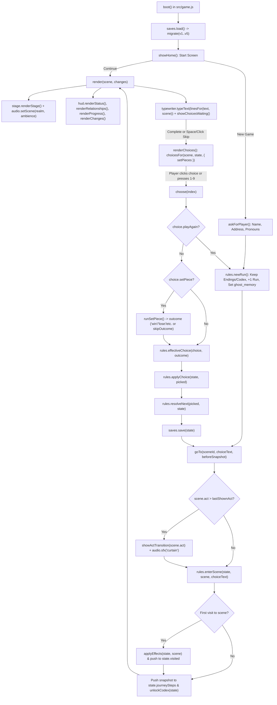
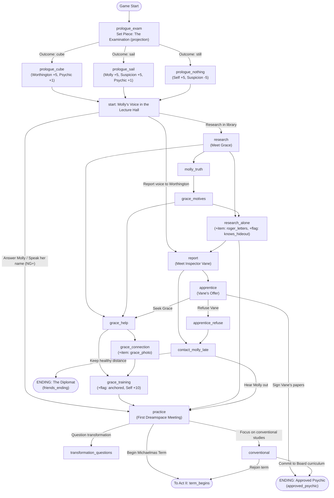
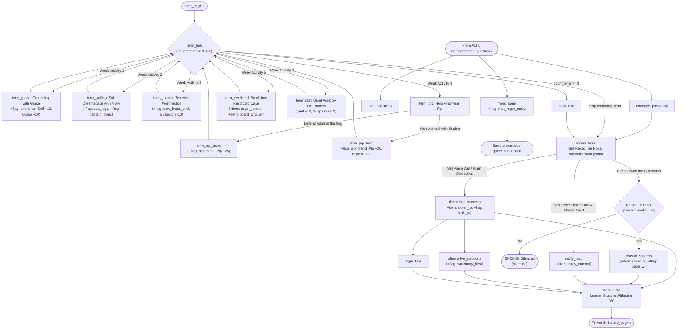
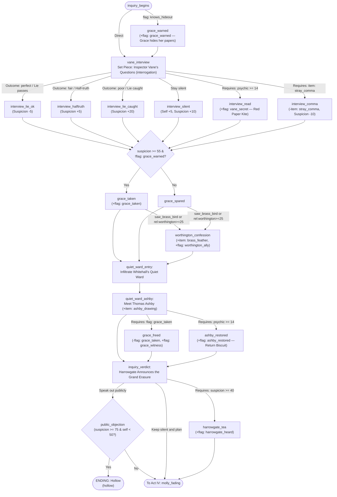
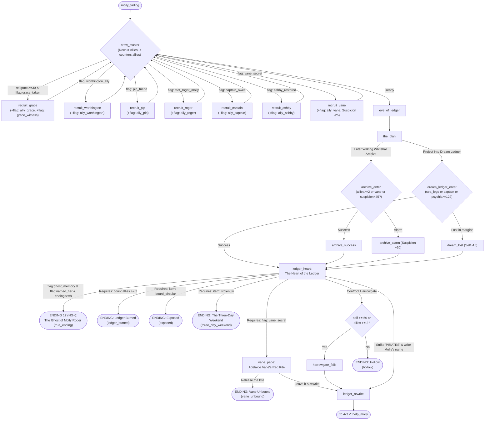
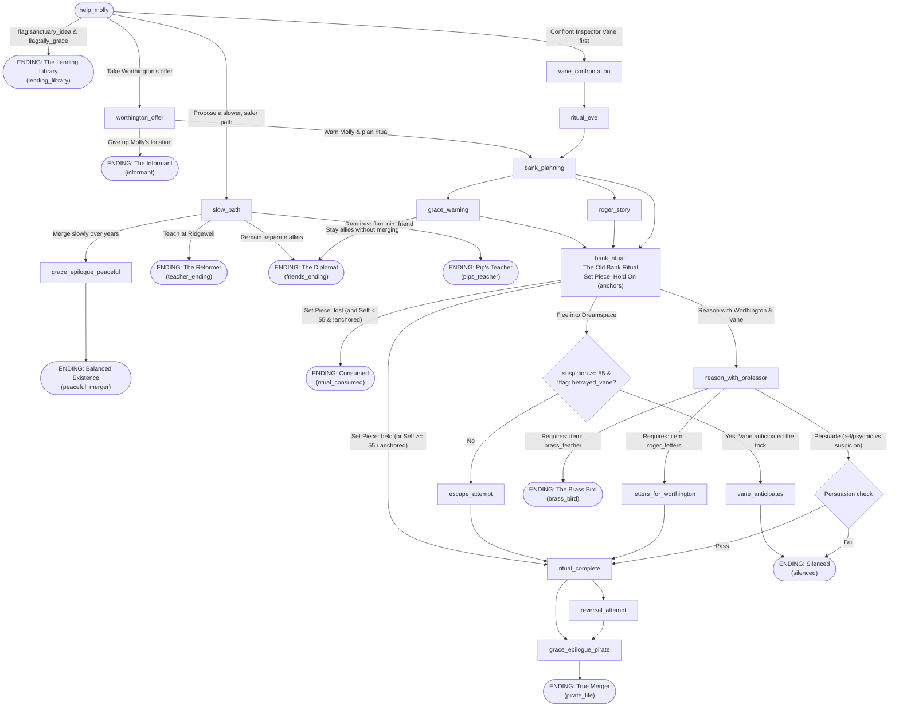

# The Ghost of Molly Roger

A branching narrative game and interactive Victorian paper theatre set in London, 1845, based on the SCP Foundation tale [*"The Ghost of Molly Roger"*](https://scp-wiki.wikidot.com/the-ghost-of-molly-roger) by psul. Licensed under [CC BY-SA 3.0](https://creativecommons.org/licenses/by-sa/3.0/) (see [`LICENSE`](LICENSE)).

Built with vanilla ES modules and Vite, the project features a zero-DOM pure rules engine, 114 scenes across six acts, 17 endings (including a New Game+ meta-ending), four playable canvas/SVG mini-games ("set pieces"), a procedural Web Audio API sound synthesizer, layered parallax SVG stage art, a static story-graph linter, and a Monte Carlo playthrough simulator.

---

## Table of Contents

1. [Quick Start & CLI Commands](#1-quick-start--cli-commands)
2. [Architecture & Runtime Flow](#2-architecture--runtime-flow)
3. [Gameplay & Narrative Flowcharts](#3-gameplay--narrative-flowcharts)
   - [High-Level Act Architecture](#high-level-act-architecture)
   - [Prologue & Act I: The Cube & Awakening](#prologue--act-i-the-cube--awakening)
   - [Act II: The Michaelmas Term & The Alphabet Heist](#act-ii-the-michaelmas-term--the-alphabet-heist)
   - [Act III: The Inquiry & The Quiet Ward](#act-iii-the-inquiry--the-quiet-ward)
   - [Act IV: Crew Muster & The Ledger Heist](#act-iv-crew-muster--the-ledger-heist)
   - [Act V: The Old Bank Finale](#act-v-the-old-bank-finale)
   - [All 17 Endings Reference](#all-17-endings-reference)
4. [Core Engine & State Model](#4-core-engine--state-model)
   - [Game State Schema & Time-Travel Snapshots](#game-state-schema--time-travel-snapshots)
   - [Variables, Stats & Path Computation](#variables-stats--path-computation)
   - [Condition DSL & Locked-Choice Hints](#condition-dsl--locked-choice-hints)
   - [Text Interpolation, Typesetting & Dialogue Attribution](#text-interpolation-typesetting--dialogue-attribution)
   - [Save Serialization & Version Migration (`v1`–`v5`)](#save-serialization--version-migration-v1v5)
5. [Interactive Set Pieces, Stage Renderer & Audio Synthesizer](#5-interactive-set-pieces-stage-renderer--audio-synthesizer)
   - [Interactive Set Pieces (`src/ui/setpieces/`)](#interactive-set-pieces-srcuisetpieces)
   - [Victorian Paper Theatre Stage (`src/stage/`)](#victorian-paper-theatre-stage-srcstage)
   - [Procedural Web Audio Synthesizer (`src/audio/audio.js`)](#procedural-web-audio-synthesizer-srcaudioaudiojs)
6. [Authoring Scenes, Story Linter & Simulator](#6-authoring-scenes-story-linter--simulator)
7. [Deployment & Security Headers](#7-deployment--security-headers)

---

## 1. Quick Start & CLI Commands

Requires **Node.js `>=20`** (see `.nvmrc`).

```bash
npm install

# Start local Vite dev server at http://localhost:5180
npm run dev

# Run static story linter + unit tests + production build into dist/
npm run build

# Serve the compiled production build in dist/ locally
npm run preview

# Run the Node test suite (27 engine, dialogue, condition, and story integrity tests)
npm test

# Validate scene graph reachability, conditions, tokens, dialogue tags, and SVG sets
npm run lint:story

# Run 20,000 random playthroughs (worst-case ending spread & gate statistics)
npm run simulate

# Run 20,000 exploratory playthroughs (prefers unvisited scenes, avoids early exits)
npm run simulate:explore

# Run a custom number of simulated playthroughs
npm run simulate -- 100000 --explore
```

---

## 2. Architecture & Runtime Flow

The codebase is strictly divided into four layers so that the story data and rules engine can run headlessly in Node.js for testing, linting, and Monte Carlo simulation:

```
index.html                     App shell, HUD sidebar, and modal overlays (About, Story, Journey, Codex, Satchel, Settings)
src/
  main.js                      Entry point: binds DOM controls, keyboard shortcuts, theme watcher, and audio unlock
  game.js                      Stateful runtime controller: navigation, typewriter orchestration, set pieces, and persistence
  engine/                      Pure, DOM-free game logic (shared with tests/ and tools/)
    rules.js                   State creation, effect application, choice filtering, snapshots, rewind, and New Game+
    conditions.js              Condition expression parser/evaluator, locked-choice hint generator, and [[if]] preprocessor
    text.js                    Player token interpolation ({name}, {lass}, pronouns), smart typography, and HTML escaping
    dialogue.js                Heuristic quote parser and speaker attribution (@speaker: tags and narrative context)
    save.js                    Versioned save/load (SAVE_VERSION = 5), migration pipeline, and localStorage/memory fallback
  story/                       Declarative narrative data
    index.js                   Merges scene modules, normalises defaults, and injects "Play Again" on endings
    acts.js                    Act definitions, dynamic sidebar objectives, and Act IV crew roster mapping
    characters.js              Character metadata, palette colours, aliases, and relationship bar config
    locations.js               24 locations mapped to SVG stage sets, realms, and particle ambiences
    items.js                   7 carryable Satchel items with Font Awesome icons and descriptions
    flags.js                   37 narrative flags with human-readable Satchel notes
    codex.js                   Unlockable lore entries (People, Roger Molly's Letters, Board Papers)
    epilogues.js               Conditional epilogue paragraphs appended to endings
    player.js                  Default player identity, forms of address, and pronoun conjugation tables
    scenes/
      prologue.js              Act 1 (Prologue - The Cube): projection exam
      act1.js                  Act 2 (Act I - Awakening): Molly's contact, Grace, Worthington, Vane's offer
      act2.js                  Act 3 (Act II - The Heist): Dreamspace training, Roger Molly, Royal Alphabet Vault heist
      act2_term.js             Act 3 (Act II - Michaelmas Term): 3-week hub and London without a W
      act3_inquiry.js          Act 4 (Act III - The Inquiry): Vane's interview, Quiet Ward infiltration, the Board's verdict
      act4_ledger.js           Act 5 (Act IV - The Ledger): Crew muster, dual-realm Ledger heist, Act IV endings
      act3.js                  Act 6 (Act V - The Old Bank): The merger ritual and Act V endings
      endings.js               All 17 ending scenes
  stage/                       Illustration panel
    stage.js                   DOM controller for parallax flats, realm curtains, cast silhouettes, and ending cards
    particles.js               HTML5 Canvas particle engine (dust, moondust, dream, letters, embers, rain, stars)
    art/
      kit.js                   Reusable SVG primitives (arch windows, gas lamps, bookshelves, ships, waves, silhouettes)
      locations.js             Layered SVG set builders for every location and variant
      portraits.js             Cut-paper profile silhouettes with 7 mood postures and rim lighting
      endingCards.js           17 bespoke tarot-style SVG cards for the Endings gallery
  audio/
    audio.js                   Procedural Web Audio API synthesizer (realm drone beds, weather ambiences, UI/set-piece SFX)
  ui/                          Browser UI components
    dom.js                     Centralised registry of DOM element IDs and HTML escaping helpers
    home.js                    Title screen controller (Continue, New Game, Endings ribbon)
    hud.js                     Sidebar status bars, Vane's tally-mark ledger, act track, crew icons, and change chips
    journey.js                 Breadcrumb bar and full Journey history modal for rewinding state
    overlays.js                Accessible modal dialog manager (focus trapping, Escape handling, aria-hidden)
    panels.js                  Character setup form, Satchel, Endings gallery, Codex tabs, and confirmation dialog
    presentation.js            Act curtain transitions and ending summary cards
    settings.js                User preferences (text speed, theme, change chips, set pieces, gentle mode, audio)
    theme.js                   Light/dark mode synchronization
    typewriter.js              Paragraph-by-paragraph typewriter with speaker badges and instant skip
    setpieces/                 Interactive mini-games
      index.js                 Set-piece dispatcher, reduced-motion handler, and visibility pause manager
      projection.js            Prologue: "The Examination" (hold-and-aim psychic focus ring)
      vault.js                 Act II: "The Royal Alphabet Vault" (grid stealth past sweeping searchlights)
      interrogation.js         Act III: "Inspector Vane's Questions" (timed composure rhythm/word challenge)
      anchors.js               Act V: "Hold On" (stormy merger survival gathering memory anchors)
  styles/                      Modular CSS (tokens, base, layout, stage, scene, systems, setpieces, overlays, ending, home)
tools/
  story-lint.js                Static analysis of scene graph, conditions, tokens, dialogue tags, and SVG builders
  simulate.js                  Monte Carlo simulator (random & exploratory agents)
  make-og-image.py             Pillow script to generate public/og-image.png
tests/
  engine.test.js               Node test runner suite
```

### Runtime Turn & Rendering Lifecycle



---

## 3. Gameplay & Narrative Flowcharts

### High-Level Act Architecture

Although the narrative displays **Prologue** through **Act V**, scenes use internal numeric act IDs `1` through `6` (`src/story/acts.js`) to trigger act curtain transitions when `scene.act > lastShownAct`.

```mermaid
flowchart LR
    subgraph Act1["Prologue: The Cube (act: 1)"]
        P["Projection Exam<br/>(prologue_exam)"]
    end

    subgraph Act2["Act I: Awakening (act: 2)"]
        A1["Molly's Contact<br/>Library, Grace & Worthington"]
    end

    subgraph Act3["Act II: The Heist (act: 3)"]
        A2Term["Michaelmas Term Hub<br/>(3 Weeks of Activities)"]
        A2Heist["Royal Alphabet Vault<br/>(Stealing the Letter W)"]
        A2Term --> A2Heist
    end

    subgraph Act4["Act III: The Inquiry (act: 4)"]
        A3Int["Vane's Interview"]
        A3Ward["The Quiet Ward<br/>(Grace & Thomas Ashby)"]
        A3Verd["The Board's Verdict<br/>(The Grand Erasure)"]
        A3Int --> A3Ward --> A3Verd
    end

    subgraph Act5["Act IV: The Ledger (act: 5)"]
        A4Crew["Muster Your Crew<br/>(Up to 7 Allies)"]
        A4Ledger["The Ledger Heart<br/>(Waking Archive / Dream Ledger)"]
        A4Crew --> A4Ledger
    end

    subgraph Act6["Act V: The Old Bank (act: 6)"]
        A5Choice["Choose Path:<br/>Slow Path, Sanctuary, or Ritual"]
        A5Ritual["The Merger Ritual<br/>(Hold On Set Piece)"]
        A5Choice --> A5Ritual
    end

    P --> A1
    A1 --> A2Term
    A1 --> A2Heist
    A1 -.->|"Early Exit"| End1(["Approved Psychic /<br/>The Diplomat"])
    A2Heist --> A3Int
    A2Heist -.->|"Caught Unprepared"| End2(["Silenced"])
    A3Verd --> A4Crew
    A3Verd -.->|"Suspicion >= 75 & Self < 50"| End3(["Hollow"])
    A4Ledger -->|"Rewrite the Entry"| A5Choice
    A4Ledger -.->|"6 Direct Act IV Endings"| End4(["The Ghost of Molly Roger /<br/>Ledger Burned / Exposed /<br/>Vane Unbound / Three-Day Weekend /<br/>Hollow"])
    A5Choice -.->|"Non-Ritual Endings"| End5(["The Lending Library /<br/>The Informant /<br/>Balanced Existence /<br/>The Reformer /<br/>The Diplomat /<br/>Pip's Teacher"])
    A5Ritual -.->|"Ritual Endings"| End6(["True Merger /<br/>Consumed /<br/>The Brass Bird /<br/>Silenced"])
```



---

### Prologue & Act I: The Cube & Awakening

In the Prologue (`src/story/scenes/prologue.js`), the player sits for the Board's psychic projection examination. In Act I (`src/story/scenes/act1.js`), Molly Roger speaks inside the player's mind during Worthington's lecture, leading to early alignment choices between Molly, Grace, Professor Worthington, and Inspector Vane.



---

### Act II: The Michaelmas Term & The Alphabet Heist

Act II (`src/story/scenes/act2_term.js` & `src/story/scenes/act2.js`) opens the **Michaelmas Term Hub** (`term_hub`). The player has **three weeks** (`counters.term < 3`) to spend on activities that build relationships, Self, Psychic level, items, and future crew allies before the dark of the moon (`heist_eve`), or they can rush straight to the heist.



---

### Act III: The Inquiry & The Quiet Ward

In Act III (`src/story/scenes/act3_inquiry.js`), Lady Harrowgate's Board of Psychic Regulation arrives at Ridgewell to hunt the culprit behind the Alphabet Vault break-in.



---

### Act IV: Crew Muster & The Ledger Heist

In Act IV (`src/story/scenes/act4_ledger.js`), the Board's ritual is already draining Molly. The player musters a crew from the allies they have earned (`crew_muster`, incrementing `counters.allies` for each recruit) and strikes at the Board's Ledger in both the waking Whitehall archive and the Dreamspace simultaneously.



---

### Act V: The Old Bank Finale

In Act V (`src/story/scenes/act3.js`), with the Grand Erasure averted and the Ledger rewritten, the player and Molly face the final question at the old bank where Roger Molly once worked: merge immediately in the ritual chamber, take the slow path over years, build a sanctuary, or betray her.



---

### All 17 Endings Reference

Every ending scene in [`src/story/scenes/endings.js`](src/story/scenes/endings.js) has a bespoke tarot card in [`src/stage/art/endingCards.js`](src/stage/art/endingCards.js) and a gallery hint. Unless `epilogue: false` is set, matching character epilogues from [`src/story/epilogues.js`](src/story/epilogues.js) are dynamically appended after a `✦` divider.

| # | Scene ID | Title | Act Reached | Realm | How to Unlock |
|---|---|---|---|---|---|
| 1 | `pirate_life` | **True Merger** | Act V | `dream` | Complete the bank ritual (`ritual_complete` -> `grace_epilogue_pirate`) by succeeding at the `anchors` set piece or holding `self >= 55` / `flag:anchored`. |
| 2 | `peaceful_merger` | **Balanced Existence** | Act V | `dream` | Choose `slow_path` in `help_molly`, then merge gradually over years (`grace_epilogue_peaceful`). |
| 3 | `approved_psychic` | **Approved Psychic** | Act I | `institution` | Sign Vane's papers in `apprentice` or commit fully to the Board's curriculum in `conventional`. |
| 4 | `teacher_ending` | **The Reformer** | Act V | `institution` | Choose `slow_path` in `help_molly`, then accept Worthington's offer to teach at Ridgewell from within. |
| 5 | `friends_ending` | **The Diplomat** | Act I or V | `neutral` | Keep a healthy distance in `contact_molly_late` (Act I), or choose to remain separate partners in `slow_path` / `grace_warning` (Act V). |
| 6 | `informant` | **The Informant** | Act V | `institution` | Betray Molly's location to Worthington and Vane in `worthington_offer`. |
| 7 | `silenced` | **Silenced** | Act II or V | `institution` | Fail the psychic check (`psychic < 7`) in `reason_attempt` during the Vault heist, fail to persuade Vane/Worthington in `reason_with_professor`, or try to flee `bank_ritual` when `suspicion >= 55` (`vane_anticipates`). |
| 8 | `ritual_consumed` | **Consumed** | Act V | `dream` | Rush the binding in `bank_ritual` and lose the `anchors` set piece (or choose plain merger) with `self < 55` and without `flag:anchored` or `flag:grace_witness`. |
| 9 | `three_day_weekend` | **The Three-Day Weekend** | Act IV | `dream` | Reach `ledger_heart` carrying `item:stolen_w` and steal Monday from the margin of the Ledger. |
| 10 | `vane_unbound` | **Vane Unbound** | Act IV | `dream` | Discover Vane's childhood secret (`flag:vane_secret` via `interview_read` with `psychic >= 14`), open her page in `ledger_heart` (`vane_page`), and release the red paper kite. |
| 11 | `lending_library` | **The Lending Library** | Act V | `neutral` | Discuss sanctuary possibilities after the Vault heist (`flag:sanctuary_idea` in `alternative_solutions`), recruit Grace (`flag:ally_grace`), and choose to turn the old bank into a lending library of projections in `help_molly`. |
| 12 | `ledger_burned` | **Ledger Burned** | Act IV | `dream` | Muster at least 3 crew allies (`count:allies >= 3`) in `crew_muster` and set the Ledger alight in `ledger_heart`. |
| 13 | `exposed` | **Exposed** | Act IV | `neutral` | Take `item:board_circular` from the Restricted Case during Michaelmas Term (`term_restricted`) and publish the Quiet Ward's 41 names to the newspapers in `ledger_heart`. |
| 14 | `hollow` | **Hollow** | Act III or IV | `institution` | Object publicly at `inquiry_verdict` with `suspicion >= 75` and `self < 50`, or confront Lady Harrowgate in `ledger_heart` with `self < 50` and fewer than 2 allies. |
| 15 | `pips_teacher` | **Pip's Teacher** | Act V | `neutral` | Befriend Pip during Michaelmas Term (`flag:pip_friend`), choose `slow_path` in `help_molly`, and open an after-hours school in the old bank. |
| 16 | `brass_bird` | **The Brass Bird** | Act V | `institution` | Notice Worthington's brass bird in `term_tutorial` (`flag:saw_brass_bird`), receive `item:brass_feather` in `worthington_confession`, and hold it up during `reason_with_professor` at the bank ritual. |
| 17 | `true_ending` | **The Ghost of Molly Roger** | Act IV (NG+) | `dream` | **New Game+ Hidden Ending:** Having discovered at least 8 endings across playthroughs (`endings >= 8`), start a run with `flag:ghost_memory`, speak Molly's name before she introduces herself in `start` (`flag:named_her`), and write all 16 lives into `ledger_heart`. |

---

## 4. Core Engine & State Model

### Game State Schema & Time-Travel Snapshots

`createState()` in [`src/engine/rules.js`](src/engine/rules.js) returns a plain serialisable object:

```js
{
    currentSceneId: "prologue_exam",
    psychicLevel: 1,              // >= 1 (never drops below 1)
    self: 100,                    // 0..100 (sense of identity; protects against being consumed in merger)
    suspicion: 0,                 // 0..100 (tally marks in Inspector Vane's ledger)
    currentPath: "Undecided",     // "Undecided" | "Rebellion" | "Institutional" | "Balanced"
    relationships: {
        "Molly Roger": 0,         // 0..100
        "Professor Worthington": 0,
        "Grace": 0,
        "Inspector Vane": 0,
        "Pip": 0                  // Hidden in HUD until `visited:term_pip`
    },
    flags: [],                    // String IDs declared in src/story/flags.js
    items: [],                    // String IDs declared in src/story/items.js
    counters: {},                 // Named integer counters, e.g. { term: 3, allies: 4 }
    visited: [],                  // Scene IDs whose first-visit entry effects have already fired
    journeySteps: [               // Full history for breadcrumbs & non-destructive rewind
        {
            sceneId: "prologue_exam",
            choiceText: null,
            snapshot: { psychicLevel, self, suspicion, currentPath, relationships, flags, items, counters, visited }
        }
    ],
    discoveredEndings: [],        // Persists across New Game+ runs
    codex: [],                    // Unlocked codex entry IDs; persists across New Game+ runs
    runs: 1,                      // Incremented on each newRun()
    player: {
        name: "Student Psychic",
        address: "lass",          // "lass" | "lad" | "matey"
        pronouns: "they"          // "she" | "he" | "they"
    }
}
```

- **First-Visit Scene Effects vs. Choice Effects**: When `enterScene(state, scene, choiceText)` is called, scene-level effects (`relationshipChanges`, `psychicChange`, `selfChange`, `suspicionChange`, `setFlags`, `addItems`, `counters`) are applied **only if `!state.visited.includes(scene.id)`**. This prevents players from farming stats by looping through hub scenes (`term_hub`, `crew_muster`). Choice-level effects (`applyChoice`) are applied every time the choice is picked.
- **Non-Destructive Rewind (`rewindTo(state, index)`)**: Clicking any breadcrumb or step in the Journey overlay restores the exact snapshot recorded at the end of `enterScene` for that step and truncates `journeySteps` to `index + 1`, while preserving meta-progression (`discoveredEndings`, `codex`, `runs`, `player`).

### Variables, Stats & Path Computation

`computePath(relationships)` recalculates `state.currentPath` after every effect application:
- **`Rebellion`**: `Molly Roger > 50` and `Professor Worthington < 30`
- **`Institutional`**: `Professor Worthington > 50` and `Molly Roger < 30`
- **`Balanced`**: `Molly Roger > 30` and `Professor Worthington > 30`
- **`Undecided`**: All other combinations

### Condition DSL & Locked-Choice Hints

[`src/engine/conditions.js`](src/engine/conditions.js) implements a deterministic micro-language used across `choice.requires`, `choice.hideWhen`, `cast[].when`, `codex[].when`, `epilogues[].when`, `acts[].objectives`, and inline `[[if ...]]` text blocks:

| Atom Syntax | Meaning | Example |
|---|---|---|
| `flag:<id>` | True if `<id>` is in `state.flags` | `flag:met_vane` |
| `item:<id>` | True if `<id>` is in `state.items` | `item:roger_letters` |
| `visited:<sceneId>` | True if `<sceneId>` is in `state.visited` | `visited:term_pip` |
| `rel:<charKey><op><int>` | Compares character relationship (`molly`, `worthington`, `grace`, `vane`, `pip`) | `rel:grace>=30` |
| `count:<name><op><int>` | Compares `state.counters[<name>] ?? 0` | `count:allies>=3` |
| `self<op><int>` | Compares `state.self` (`0`–`100`) | `self<50` |
| `suspicion<op><int>` | Compares `state.suspicion` (`0`–`100`) | `suspicion>=40` |
| `psychic<op><int>` | Compares `state.psychicLevel` | `psychic>=14` |
| `endings<op><int>` | Compares `state.discoveredEndings.length` | `endings>=8` |
| `!<atom>` | Negates any atom | `!flag:grace_taken` |
| `<atom> & <atom>` | Logical AND across atoms | `item:grace_photo & rel:grace>=20` |

Supported comparison operators (`<op>`): `>=`, `<=`, `>`, `<`, `==`, `!=`.

When a choice's `requires` expression evaluates to `false`:
- If `hideLocked: true` is set on the choice, `choicesFor()` omits the choice completely.
- Otherwise, the choice is rendered disabled with a lock icon and an automatically generated human-readable hint from `checkRequirement()` (e.g., `"Requires A faded photograph · Grace's trust at least 20"`), unless overridden by `choice.lockedHint`.

### Text Interpolation, Typesetting & Dialogue Attribution

1. **Conditional Blocks (`renderConditionals`)**: Resolves `[[if COND]]...[[else]]...[[/if]]` from the innermost block outward so nested conditionals work cleanly. Blank lines left behind by hidden blocks are collapsed automatically.
2. **Player Tokens (`applyTokens`)**: Replaces `{name}`, `{lass}` (`lass` / `lad` / `matey`), `{they}`, `{them}`, `{their}`, `{theirs}`, `{themself}`, `{they_are}`, `{they_were}`, `{they_have}`. Capitalising the first letter of any token (e.g. `{They_are}`, `{Lass}`) capitalises the substituted word.
3. **Smart Typography (`typeset`)**: Converts straight single/double quotes into curly quotes (`‘…’`, `“…”`), preserves contractions and decades (`’em`, `’21`, `plunderin’`), converts spaced hyphens (` - `) into en-dashes (` – `), and converts `...` into `…`.
4. **Automatic Dialogue Attribution (`src/engine/dialogue.js`)**:
   - Splits scene text into paragraphs and identifies quoted speech runs.
   - Determines who is speaking using four rules in priority order:
     1. Explicit prefix tag at the start of a paragraph: `@molly:`, `@worthington:`, `@grace:`, `@vane:`, `@pip:`, `@harrowgate:`, `@ashby:`, `@roger:`, `@captain:`, `@you:` (player), or `@none:` (unattributed quote such as a written note or inscription). Tags are stripped before display.
     2. Second-person speech verbs in the narration outside the quotes (`you say`, `you ask`, `you whisper`, etc.) -> attributes to `PLAYER`.
     3. First character alias mentioned in the narration outside the quotes (e.g. `'Again,' Worthington says.`).
     4. Carry-over from the preceding paragraph's speaker or the character named in a short preceding narrative beat, falling back to `scene.speaker`.

### Save Serialization & Version Migration (`v1`–`v5`)

[`src/engine/save.js`](src/engine/save.js) stores state under the `localStorage` key `"molly-roger-save"` (falling back to in-memory session storage if `localStorage` is blocked in private browsing). `migrate(data)` upgrades any historical save payload to `SAVE_VERSION = 5`:
- **`v1 -> v2`**: Backfills `Inspector Vane` relationship, constructs `visited` arrays from `journeySteps`.
- **`v2 -> v3`**: Adds `self` (100), `suspicion` (0), `flags` (`[]`), `items` (`[]`), and `player` identity across both top-level state and historical snapshots.
- **`v3 -> v4`**: Adds `counters` (`{}`) and `Pip` relationship bar.
- **`v4 -> v5`**: Adds `codex` (`[]`) and `runs` (`1`).
- **Scene Pruning**: If a save points at a `currentSceneId` that no longer exists, `migrate()` returns `null` to start fresh; deleted scenes in `journeySteps` or `discoveredEndings` are filtered out safely.

---

## 5. Interactive Set Pieces, Stage Renderer & Audio Synthesizer

### Interactive Set Pieces (`src/ui/setpieces/`)

When a choice includes `setPiece: "<name>"`, picking it mounts an interactive mini-game inside `#choices-container`:

| Set Piece ID | Title | Scene | Mechanics & State Modifiers | Outcomes |
|---|---|---|---|---|
| `projection` | **The Examination** | `prologue_exam` | Hold Space/button as a breathing focus ring contracts toward a target band, then release. Holding past the band conjures a three-masted schooner (`sail`). | `cube` (skip default), `sail`, `still` |
| `vault` | **The Royal Alphabet Vault** | `dream_heist` | Navigate a 7x5 grid from the entry to the `W` plinth past sweeping Board searchlights using arrow keys / WASD / click. Having `flag:sea_legs` grants an extra beat of grace when clipped by a light. | `win` (skip default), `lose` |
| `interrogation` | **Inspector Vane's Questions** | `vane_interview` | Three rounds of timed answers where Vane's composure needle sweeps across a safe window. Window width scales with `state.self`; needle speed increases with `state.suspicion`. | `perfect`, `fair` (skip default), `poor` |
| `anchors` | **Hold On** | `bank_ritual` | Survive the storm of the merger by collecting drifting memory anchors before your Self meter empties. `flag:anchored` and `flag:grace_witness` add bonus starting anchors and slow drain. | `held` (skip default), `lost` |

**Accessibility & Fallbacks**:
- Every set piece shows a **Begin** screen with instructions and a **"Skip – decide for me"** button that resolves immediately to `choice.skipOutcome`.
- Toggling **"Play interactive set pieces"** off in Settings (or enabling OS `prefers-reduced-motion` on initial load) hides set-piece choices and reveals the scene's `plainOnly: true` narrative choices instead.
- Enabling **Gentle mode** in Settings widens timing windows and slows hazards across all four mini-games.

### Victorian Paper Theatre Stage (`src/stage/`)

- **Layered Parallax Scenery (`src/stage/art/locations.js`, `kit.js`)**: Each location is built from SVG `<g class="flat" data-depth="...">` layers (`depth` from `0.05` sky backdrop to `0.90` foreground frame). Pointer movement across `#stage` translates each layer proportionally to its depth.
- **Realm Transitions (`src/stage/stage.js`)**: Moving between locations triggers a realm-specific curtain (`institution`: dark ink wipe; `dream`: violet chromatic tear; `neutral`: warm lamplight crossfade).
- **Cast Silhouettes (`src/stage/art/portraits.js`)**: Characters render as cut-paper profile silhouettes lit by their signature colour (`--speaker`). Up to two characters can stand on stage (`left`, `right`, or `center`), with 7 mood modifiers (`neutral`, `pleased`, `angry`, `afraid`, `sad`, `stern`, `thoughtful`) that adjust posture and rim light. Non-speaking characters step back into shadow.
- **Particle Canvas (`src/stage/particles.js`)**: A `requestAnimationFrame` canvas overlay draws location-appropriate atmospheric particles (`dust`, `moondust`, `dream`, `letters`, `embers`, `rain`, `stars`), pausing automatically when the browser tab is hidden or `prefers-reduced-motion` is active.

### Procedural Web Audio Synthesizer (`src/audio/audio.js`)

All sound is generated procedurally at runtime using the Web Audio API—no `.mp3` or `.wav` assets are loaded:
- **Realm Drone Beds**:
  - `institution`: Low filtered room tone + periodic mechanical clock tick (`800 Hz` / `620 Hz` alternating bandpass clicks).
  - `dream`: Shimmering detuned chord (`D3`, `A3`, `F4`, `A4`, `C5`) modulated by slow LFOs.
  - `neutral`: Warm lowpass noise bed.
- **Ambience Layers**: Filtered pink/white noise shaped by LFOs for `rain` (patter), `dream`/`letters` (rolling sea surf), and `embers` (hearth crackle).
- **Sound Effects (`sfx(kind)`)**: Synthesizes `choice`, `curtain`, `item`, `ending`, `tick`, `good`, and `bad` cues using envelope-shaped oscillators.

---

## 6. Authoring Scenes, Story Linter & Simulator

### Scene & Choice Specification

```js
my_scene_id: {
    act: 3,                          // 1..6 (Prologue = 1, Act I = 2, ..., Act V = 6)
    theme: "dream",                  // "institution" | "dream" | "neutral"
    location: "dreamspace",          // Key from src/story/locations.js
    speaker: "Molly Roger",          // Default speaker name from characters.js, or null
    cast: [                          // Optional explicit stage placement (defaults to speaker on right)
        { who: "Molly Roger", mood: "pleased", pos: "right" },
        { who: "Grace", mood: "thoughtful", pos: "left", when: "flag:ally_grace" }
    ],
    text: "'Ahoy, {lass}!' [[if item:stolen_w]]The W hums in your pocket.[[/if]]",

    // Optional first-visit entry effects:
    relationshipChanges: { "Molly Roger": 10 },
    psychicChange: 1,
    selfChange: -5,
    suspicionChange: 10,
    setFlags: ["met_vane"],
    clearFlags: [],
    addItems: ["roger_letters"],
    removeItems: [],
    counters: { term: 1 },

    choices: [
        // 1. Standard choice
        {
            text: "Ask Grace about the letters",
            nextScene: "other_scene",
            relationshipChanges: { "Grace": 5 }
        },
        // 2. Gated choice (greyed out with auto-hint unless hideLocked: true)
        {
            text: "Show Grace the faded photograph",
            nextScene: "roger_story",
            requires: "item:grace_photo & rel:grace>=20",
            hideLocked: false,
            hideWhen: "visited:roger_story"
        },
        // 3. Dynamic branch (must declare all possible return IDs in `targets` for the linter)
        {
            text: "Attempt a risky psychic deflection",
            risky: true,
            nextScene: s => (s.psychicLevel >= 10 && s.self >= 60 ? "deflect_ok" : "deflect_fail"),
            targets: ["deflect_ok", "deflect_fail"]
        },
        // 4. Interactive set-piece choice (paired with plainOnly fallbacks)
        {
            text: "Slip past the searchlights",
            setPiece: "vault",
            skipOutcome: "win",
            outcomes: {
                win: { nextScene: "distraction_success", psychicChange: 3 },
                lose: { nextScene: "molly_lead", suspicionChange: 10 }
            }
        }
    ]
}
```

### Static Story Linter (`tools/story-lint.js`)

Running `npm run lint:story` (automatically executed before `npm run build`) performs 12 static verification passes and fails with exit code `1` on any error:
1. **Schema Validation**: Rejects unknown keys on scenes, choices, and set-piece outcomes to catch typos early.
2. **Reference Integrity**: Verifies all `location`, `speaker`, `cast[].who`, `cast[].mood`, `setFlags`, `clearFlags`, `addItems`, `removeItems`, `relationshipChanges`, `codex`, and `crew` references exist.
3. **576-State Dynamic Probe**: Evaluates every dynamic `scene.text(state)` and `choice.nextScene(state)` function across a Cartesian grid of 576 probe states (`psychicLevel`, `relationships`, `self`, `suspicion`, and empty/full `flags`, `items`, `counters`), verifying that every returned scene is listed in `choice.targets` and every target is reachable.
4. **Template & Dialogue Tag Validation**: Ensures balanced `[[if ...]]` / `[[/if]]` blocks, valid condition grammar, known `{token}` names, and valid `@speaker:` tags.
5. **Soft-Lock Prevention**: Ensures no non-ending scene has zero choices or has `requires` on every single choice.
6. **Graph Reachability & Ending Convergence**: Runs a breadth-first search from `START_SCENE` (`prologue_exam`) to verify every scene is reachable, and a reverse fixed-point pass to verify every non-ending scene can reach at least one ending.
7. **Dead Flag/Item Detection**: Errors if any condition checks a flag or item that is never granted anywhere in the story; warns if a declared flag or item is never set.
8. **SVG Set Smoke Test**: Invokes every location's SVG set builder `sets[loc.set](loc.variant)` to ensure none throw at render time.

### Monte Carlo Playthrough Simulator (`tools/simulate.js`)

Running `npm run simulate` (random agent) or `npm run simulate:explore` (curious agent that prefers unvisited scenes and avoids early endings) executes 20,000 playthroughs against the pure engine (`src/engine/rules.js`) and prints:
- Average, min, and max scenes per playthrough, plus stuck/loop detection (`0` stuck runs allowed).
- Distribution histogram across all 17 endings (including simulated New Game+ runs where unlocked endings and codex entries carry forward).
- Gate pass rates for every `requires` expression in the game, flagging any choice gate that never unlocks (`0%`) or is trivially always unlocked (`100%`).

---

## 7. Deployment & Security Headers

The project is pre-configured for static hosting (such as Netlify via [`netlify.toml`](netlify.toml) or any static file server):

- **Relative Asset Paths**: [`vite.config.js`](vite.config.js) sets `base: "./"`, allowing the compiled `dist/` directory to be deployed either at a domain root or inside a subdirectory.
- **Bundled Typography**: Inter, Geist, and DM Mono are bundled locally via `@fontsource` packages so no external Google Fonts requests are made.
- **Security Headers (`netlify.toml`)**: Configures `Content-Security-Policy`, `X-Frame-Options: DENY`, `X-Content-Type-Options: nosniff`, `Referrer-Policy: strict-origin-when-cross-origin`, and immutable caching (`max-age=31536000, immutable`) for hashed `/assets/*` bundles.
- **OpenGraph Preview Image**: [`public/og-image.png`](public/og-image.png) can be regenerated at any time with `python3 tools/make-og-image.py` (requires Pillow).
